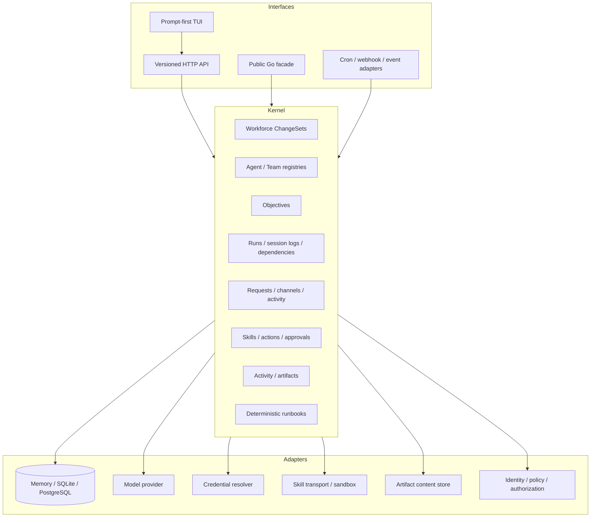
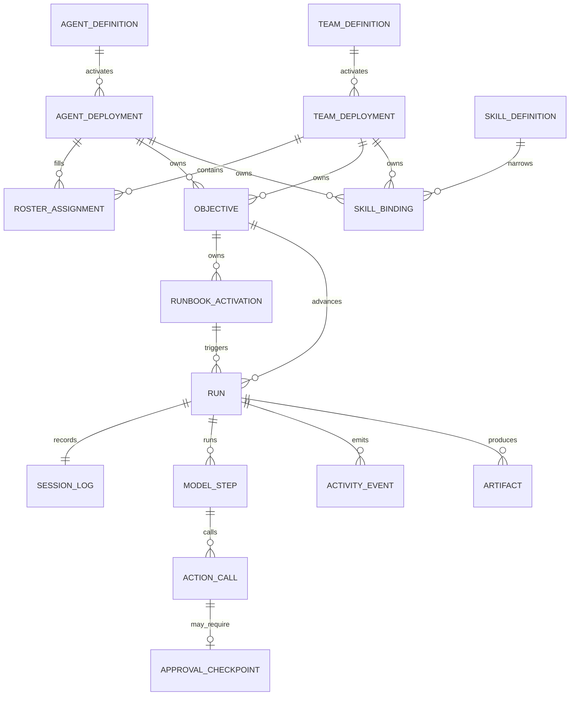
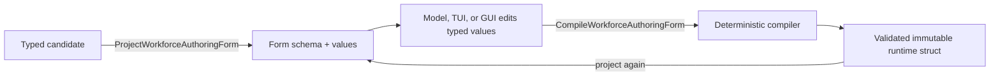
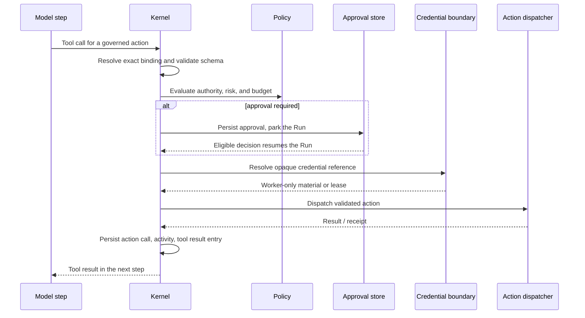

# Autonomous agent runtime architecture

This document describes the OpenSeal architecture implemented in this
repository. It separates portable kernel guarantees from optional standalone
and embedding adapters.

## Runtime layers

`github.com/axiom-studio/openseal/pkg/openseal` is the supported embedding
facade. The standalone daemon constructs the same `Engine`, adds SQLite and
local artifact storage, registers its optional adapters, and exposes it through
`/api/v1`. Downstream programs should not import OpenSeal `internal` packages.

## Canonical resource graph

References are validated inside an explicit scope. Definitions are immutable
and versioned. Deployments are mutable activations with optimistic revisions.
Agents and Teams are peer owners of objectives, Runs, Skills, activity, and
artifacts; Teams additionally add roster and collaboration policy.

### Team coordination

Team channels use one relevance-arbitrated coordination model. There is no
leader-only, peer, or dynamic mode switch: those labels previously projected
the same runtime and made the contract misleading. Every active participant
observes the shared channel context and may propose a contribution. The
deterministic arbiter then applies the Team's explicit controls:

- quiet-by-default materiality;
- required or preferred role relevance;
- duplicate-content suppression;
- maximum speakers and concurrency;
- audience, mention, thread, and role-participation boundaries.

Leaders can coordinate through an ordinary semantic role and relevant
handoffs, summaries, or decisions, but they are never mandatory spokespeople.
Exact governed actions remain idempotently deduplicated even when repeated
conversation content is allowed.

## Prompt-first authoring

Natural-language authoring compiles to a durable **Workforce ChangeSet**, not a
direct registry mutation. The ChangeSet stores the original request,
generation Run, candidate, typed refinements, exact Skill placement,
validation diagnostics, policy findings, approval requirements, decisions,
revision, digest, and apply receipt.

Generation is claimed by a leased worker and can recover after process failure.
The candidate may contain one Agent, several Agents, a Team, objective
templates, and Skill requirements. The compiler never
invents a credential value, source allowlist, or approval authority.

Models and product surfaces do not edit compiler-owned kernel fields. OpenSeal
projects typed structs into a versioned authoring form whose fields carry
labels, help, input kinds, choices, and enablement conditions. The submitted
form contains typed values keyed by stable field and subject identifiers. A
deterministic codec validates those values and derives the immutable runtime
struct; the same codec projects that struct back into editable form values for
amendment and review.

For example, an endpoint form exposes an **Approvals** purpose only when its
authorized adapter accepts approval decisions. Selecting it compiles the exact
Agent approval destination. The model never writes `approvalDestinations`,
provider bindings, or principal mappings directly.

Application is atomic in persistent stores: reviewed Agent/Team definitions,
deployments, objective instances, Skill bindings, and the
receipt commit together. Expected revision, candidate digest, and idempotency
key prevent stale or duplicate application.

## Durable execution

OpenSeal models continuous autonomy as a sequence of durable Runs, not one
immortal model request. A Run is one agent loop: model steps call tools until
a final answer, an approval, or a wait. Every step is recorded in the Run's
append-only session log, which is the only execution state the kernel resumes
from.

1. A prompt, Runbook trigger, conversation command, request, or API
   call creates or wakes a Run.
2. The scheduler selects an eligible Run subject to status, dependencies,
   wake conditions, priority, budget, and concurrency.
3. A worker claims it with a bounded lease.
4. The worker loads the exact Agent/Team definition versions, objective,
   policy, active Skill surface, and the Run's session log.
5. Each model step sends the system prompt and the log's active path to the
   step host and appends the assistant entry with its tool calls. The kernel
   executes the calls (governed Skill actions inline, host tools on the step
   host, control tools such as delegation, forks, waits and the final answer
   in the kernel) and appends each result to the log before the next step.
6. The loop ends the Run on a final answer, or parks it without holding a
   worker on an approval, a dependency, another Agent, or an event. A claim
   yields after 50 steps or 8 minutes, and the next claim continues from the
   log.
7. Lease expiry makes interrupted work reclaimable. The next claim reloads the
   log: finished tool calls keep their results, reads that never started run
   again, and an interrupted write is recorded as possibly applied rather than
   sent twice.

When the active path approaches the model's context window, the kernel
compacts it into a summary entry and continues from there. Independent Runs
and child Runs provide concurrency. One claimed Run remains single-writer.
Budget reservations and idempotent action records prevent duplicate spend and
duplicate side effects across retries.

## Multi-objective scheduling and events

Each Agent or Team can own a portfolio of Objectives. An Objective says what
outcome matters; one or more versioned Runbooks beneath it say how work is
performed. Activated Runbook schedule triggers own persisted cursors, cron
jitter, concurrency, inputs, policy, and deterministic occurrence keys. A due
trigger creates a bounded Run attributed to both the Objective and the exact
Runbook activation.

Event routines are routine activations whose trigger is an event. Producers
(chat ingress, GitHub callbacks, and host adapters such as webhook ingress and
Google sync) offer normalized `RoutineEvent`s to the routine event matcher,
which stores matching events with a dedupe key. A separate dispatcher, run by
one leader process, starts one bounded Run per batch of events under per-routine
and per-tenant limits. Producers are not execution engines; they never create
Runs. See [Event routines](../event-routines.md).

## Skills and action governance

The canonical Skill catalog is source-aware. Two definitions with the same ID
and version but different source identities remain distinct variants. Bindings
select the exact source-qualified definition, allowed actions, prompt exposure,
risk ceiling, configuration, constraints, and opaque credential references.

Action execution follows this order:

The model never receives resolved secret values. A host dispatcher is guarded
at the final external boundary as well as when the call is admitted. Team-owned actions
also validate the Team skill grant and assigned Agent authority.

## Collaboration

Agent requests and handoffs create durable relationships between Runs. A Team
request can be assigned to one roster Agent under delegation policy. The
receiver keeps its own Skills, credentials, budgets, and policy.

The recipient inbox is a kernel reconciliation loop rather than a
human-authored Agent response. Creating a singular request and moving its source
Run into `waiting_for_agent` is one atomic store operation. Explicitly
preauthorized delegation is accepted idempotently; ordinary delegation from
the agent loop uses recipient review. The inbox creates a bounded, decision-only Run owned by
the recipient. Agent recipients review their own request; Team recipients
choose the first eligible active roster assignment deterministically and honor
the active Team definition's acceptance policy. The decision Run may only
return `accept`, `reject`, or `request_clarification`; action execution,
forking, and further delegation fail closed. Applying the decision verifies the
completed Run, assigned Agent, recipient owner, request identifier, and exact
request revision. Rejecting or requesting clarification atomically resumes the
source with a structured collaboration result. Providing an answer atomically
returns it to the wait state, and the new request revision receives a distinct
decision Run whose input contains the question and response. Accepted work is a
separate child Run, preserving a clear boundary between deciding to take work
and doing it.

A bounded Run funds the child Runs it creates through control tools
(delegation, forks, and tasks) from its own remaining budget. The `Turns`
dimension counts model steps. Each positive bounded child dimension must meet a
kernel floor for a viable child: 8 model steps, 3 attempts, 16,384 input
tokens, the hosted minimum output allowance, 180,000 ms, and one action. The
aggregate of a fork must fit the source Run's remaining capacity. A call that
asks for more than the Run can fund gets the tool error `budget_insufficient`
before any request or child Run is created, and the Agent continues locally,
finishes with a bounded result, or surfaces that constraint. An unbounded
parent dimension remains unbounded.

Conversations persist messages, reply and mention structure, participant
cursors, leased presence, incremental change sequences, and participation
rounds. Arbitration records who was eligible, who was suppressed, and why. A
conversation Run reconciler can turn accepted channel participation into
ordinary Runs; messages remain a projection and command surface over canonical
work.

## Activity and artifacts

Activity is append-only and scoped. Run, action, approval, request, Team,
conversation, source, and artifact services emit the same activity envelope.
Clients can request compact projections and fetch detailed events without
exposing provider chain-of-thought.

Artifacts store immutable metadata, versions, hashes, provenance, retention,
and an opaque content reference. Content upload/download is an optional adapter.

Short-lived files passed into an execution sandbox are not Artifacts. The
portable execution transport bounds their size and lifetime, exposes only
opaque identifiers, and is intentionally lost across process restart. A host
must promote any durable result into the Artifact catalog and content store.

## Storage implementations

- **Memory** is the default for programmatic construction and tests. It is not
  durable across process exit.
- **SQLite** is the standalone store. It persists the complete kernel surface
  in one database and is used by the daemon.
- **PostgreSQL** is the shared embedded store. It applies timestamp-versioned
  schema migrations under a migration lock and supports configurable pooling
  and schema names.

All stores implement the same scoped service contracts. Recovery tests cover
leases, retries, idempotency, cancellation, action state, collaboration,
conversation changes, source checkpoints, ChangeSet application, and artifacts.

## Capability truth

The HTTP server exposes a static route set but constructs its capability
document from the stores and adapters actually installed. Optional operations
such as Run creation, action approval resolution, workforce lifecycle
decisions, and artifact content are advertised only when wired.

The TUI loads that document before rendering its workspace. It does not
manufacture permissions, statuses, approval eligibility, or durable state. An
embedding graphical client must follow the same rule.

## Extension boundary

The public facade exposes types and configuration options for persistent
stores, dynamic worker scopes, turn runners, action policy, approval
authorization, credential resolvers or leases, action dispatch, Skill discovery,
source artifact storage, conversation coordination, Team
management, and Skill management.

OpenSeal validates portable semantics and fails closed when a necessary adapter
is absent. It does not pretend to provide tenant identity, a host secret service,
remote sandbox provisioning, external network credentials, or organization
policy in standalone defaults.

### Channel participation opt-in

Embedding hosts can require explicit per-channel participation by setting
`RequireParticipationOptIn` on both the conversation scheduler and turn runner.
The engine rejects mismatched policies. The default remains compatible with
existing hosts. The desktop enables this policy on both components and exposes
explicit per-channel Team replies settings.

`conversation.Service.UpdateConversation` accepts `ParticipationEnabled` under
revision control. Enabling records the channel's current sequence as a boundary:
only subsequent messages qualify. Repeated enabling preserves that boundary;
disabling and re-enabling skips messages received before the new boundary.
Archiving disables participation, and restoring a channel does not re-enable it.
The opt-in survives store restart. Queued Runs recheck the canonical channel
before execution. Late Agent replies and proposed operations are discarded after
opt-out while reported model usage remains charged. Team round publication uses
revision checks to reject a round computed against an outdated channel.

Opt-out does not undo already completed work or cancel actions already admitted
for execution. Host authorization, participant eligibility, model budgets, and
usage accounting remain enforced by the desktop host.

### Team replies and usage

A host that bounds Team replies configures `conversationrun.SchedulerConfig.Budget`;
the scheduler copies that policy onto each new conversation Run. An unaddressed
Team message first runs a routing step that picks one member, and the chosen
member answers in its own conversation Run, an ordinary agent loop. Every model
step reserves its budget before the provider call and settles the reported
usage afterwards, so an insufficient remaining budget pauses the Run before the
step runs. Usage is host-reported per step, never taken from model output, and
a step replayed after a crash is not charged twice.

### Desktop participation host adapters

`internal/daemon.DesktopConversationParticipants` resolves the current local Team
roster and its exact active definition. It excludes observe-only/disabled members
and inactive Agents, rejects pending Team activation, checks Agent definitions
against member requirements, and enforces the participant limit. Definition and
scope mismatches fail closed. Deployment-specific model credentials are rejected
because this desktop adapter uses the workspace provider; no credential is
transferred through the participant binding.

`DesktopConversationRouter` picks the answering member with one small call to
the workspace provider, sharing the step host's client; it posts nothing, and
on any error the kernel applies its fixed fallback order. Member answers run on
the desktop step host like any other Run. Channel text is untrusted
conversation content, and a reply is linked to the original trigger, so the
conversation service enforces the original thread's visibility.

Channel settings persist explicit opt-in/off through revision-checked PATCH
and recovery-by-read after uncertain delivery. Configuration remains available
without a provider for opt-out; automatic replies do not.

Desktop bounds are eight eligible participants and the 10 most recent messages
for the router. Conversation runs allow 12 model steps, four attempts,
1,728,000 total tokens, 49,152 output tokens, and 180,000 ms.

Full Go suites/race checks, 106 desktop browser tests, and Linux native smoke passed
with synthetic providers. Live provider quality and other operating systems remain
unverified; this bounded integration does not certify overall app completion.
